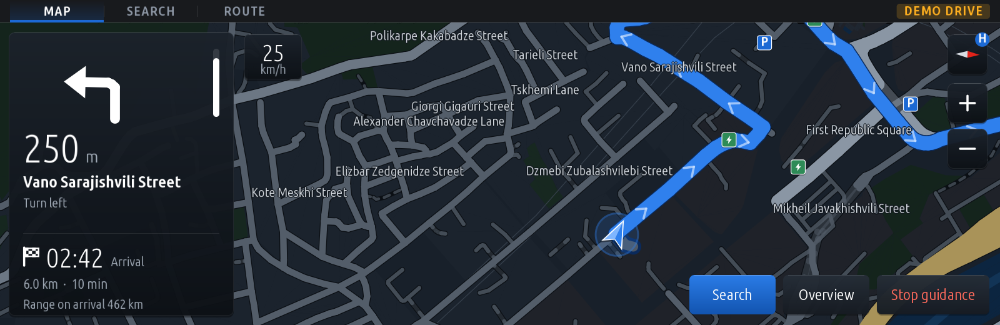
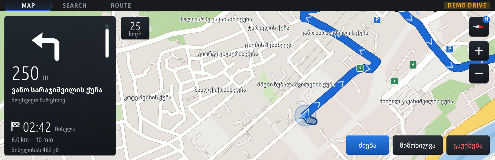
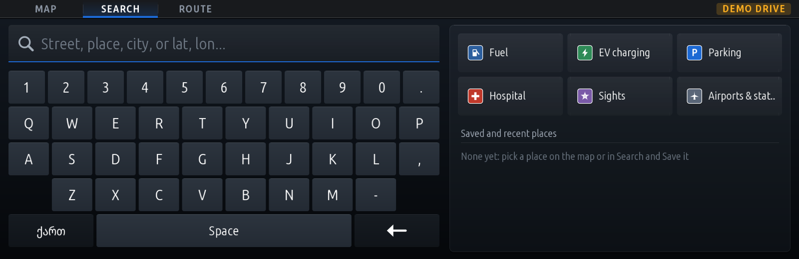
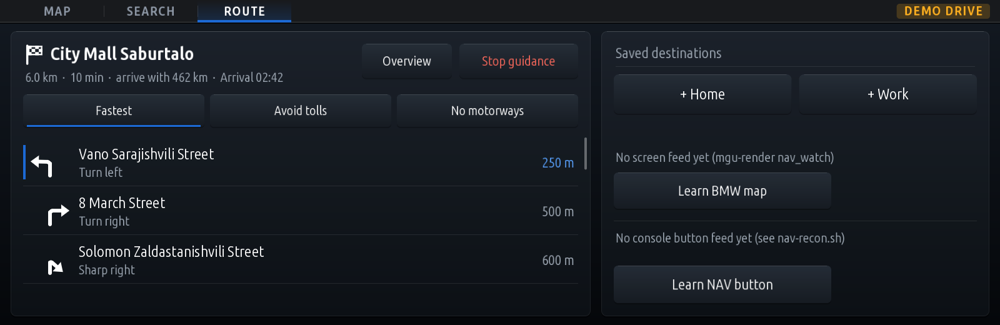
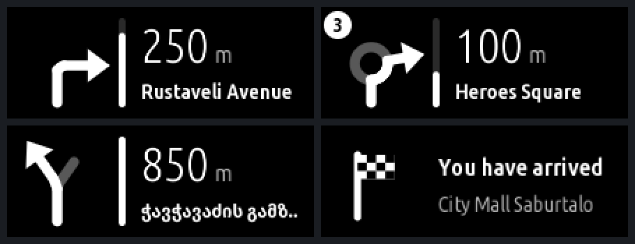
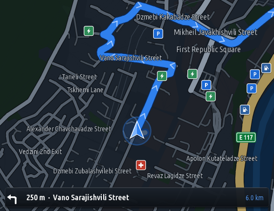

# BMW iDrive 7 (MGU) — Offline Navigation (`osm_nav`)

> [!CAUTION]
> **EXTREMELY EXPERIMENTAL. It has not been run in a car yet.** Everything below was built and tested on a PC only
> (unit tests, the PC preview and the emulator). It may not install, may not find the car's position, and may
> show wrong directions. **Never rely on it to drive, and keep your eyes on the road.** Install it only if you
> can get a head unit back to stock yourself (SSH access, the MGU Store's uninstall). You use it at your own risk.

<p align="center">
  <b>Offline OpenStreetMap navigation for BMW iDrive 7 (MGU High / Intel Atom A3960), in place of the BMW map, which has no usable map of Georgia. It looks and works like iDrive 7's own Navigation: the map drawn on the head unit's GPU in the BMW map's style, the menus as the car's own lists, the next turn on the head-up display. Installed through the MGU Store.</b>
</p>

<p align="center">
  
  
  
  
</p>

---

## Screens

Rendered by the PC preview (`kit/tools/preview.js`, the Tbilisi demo drive). The car's own lists (Navigation's menu, its lists, the settings) are drawn by the HMI itself, so the preview cannot show them; on the car the header's third tab reads *Menu* and opens them. Without them (*Settings > Menus > Drawn*, and in the preview) it is the drawn *Route* page below.

<p align="center">
  <br>
  <sub>Guidance at night: BMW's column on the left (the arrow and its distance bar, the street, the arrival under the chequered flag, range on arrival), the speed, the map tiles on the right, the actions at the bottom right.</sub>
</p>
<p align="center">
  <br>
  <sub>Day colours, street names and guidance in Georgian.</sub>
</p>
<p align="center">
  <br>
  <sub>The speller (iDrive 7 gives apps no text entry, so this page is drawn): Latin, Georgian and coordinates; categories and saved places beside it. It locks while the car drives.</sub>
</p>
<p align="center">
  <br>
  <sub>The drawn Route page (the native menu's stand-in): the maneuvers ahead, the route preference, saved places, learning the BMW map and the NAV button.</sub>
</p>
<p align="center">
  &nbsp;&nbsp;
  <br>
  <sub>Left: the next turn as it goes to the head-up display (twice its size; black is see-through on the glass). Right: the home-screen widget.</sub>
</p>

---

## Credits & Acknowledgements

This repository is built on the open-source BMW iDrive 7 platform:

* [**cauliflowermossgrape/idrive7-apps**](https://github.com/cauliflowermossgrape/idrive7-apps) — the app runtime, the native OpenGL ES renderer and SOME/IP vehicle signals.
* [**mgu-store**](https://github.com/robertnisipeanu/mgu-store) — the in-car app store, package manager and internet uplink by Robert Nisipeanu.
* [**robertnisipeanu/idrive-apps**](https://github.com/robertnisipeanu/idrive-apps) — cluster-render, the service the head-up display arrows are drawn through (Navigation speaks its documented protocol with a small client of its own).
* [**nhocleopro/hud-widgets**](https://github.com/nhocleopro/hud-widgets) — found the car navigation's position service (`navigation.positioning.Positioning`) and read it on a car, and found that a picture on the HUD hides the cruise-control readout.
* **Redline** in [cauliflowermossgrape/idrive7-apps](https://github.com/cauliflowermossgrape/idrive7-apps) — where on the glass directions go, clear of BMW's speed, and how to tell that BMW navigation, CarPlay or Android Auto is guiding.
* [**dorindumitras/ambient-drive**](https://github.com/dorindumitras/ambient-drive) — the example of an app built from the car's own native screens.
* Map data © [OpenStreetMap](https://www.openstreetmap.org/copyright) contributors (ODbL), extracts by [Geofabrik](https://download.geofabrik.de/).

> [!NOTE]
> For SDK extraction, toolchain documentation, SOME/IP signal catalogs and renderer internals, see [**cauliflowermossgrape/idrive7-apps**](https://github.com/cauliflowermossgrape/idrive7-apps).

---

## Status

| Part | State |
| :--- | :--- |
| Map, routing, guidance, search, fuel logic | Works on the PC (tests, preview). **Not run on a head unit.** |
| Crashes, memory, CPU | Checked on the PC only, on the head unit's Node 8.9.4: no uncaught error when the HMI refuses every call, the car's signals carry nonsense or cluster-render misbehaves (an uncaught error would make MainApp wipe the app, and remove it at the second). A 7-minute demo drive held about 112 to 119 MB, as 1.0.3 did. MainApp stops the app above 192 MB and runs it at low priority, so the HMI keeps the CPU first. |
| The car's GPS position | **Wired, not seen on this app's cars yet.** Since 1.1.0 the app reads the car navigation's own position (`navigation.positioning.Positioning`: `rawPositionData`, `currentLocation`), the interface and field layout [nhocleopro/hud-widgets](https://github.com/nhocleopro/hud-widgets) found and read on a BMW X3 G01 LCI (iDrive 7, `L18_22w10.5`, 2026-11-12: a valid 3D fix about 9 m from a phone's GPS, parked). Not known: whether older firmware (MainApp 6.5.5) has it (the install then leaves it out), how often it updates while driving, and whether it still gives a fix in Georgia, where the BMW map has no data. Between fixes, and without them, the position is estimated from the car's speed and turning (it drifts). |
| Console NAV button opens Navigation | **Not on a car yet**: needs the controller gate (`mgu-inputgate.so`) built with the NAV hook in `kit/renderd/inputgate`. It now builds (Docker, the car's Ubuntu 18.04 libraries) and passes `make test-inputgate`, but the gate the MGU Store installs does **not** have the hook, and ours is not checked against a car's libraries yet (`build-facts.txt` from `nav-recon.sh`). |
| Opening in place of the BMW map (side menu NAV icon, the Navigation tile, voice) | **Not on a car yet**: needs our renderer build with `nav_watch` (`kit/renderd`; the store's renderer does not have it), and the BMW map learned in the Navigation menu (or on the Route page); or, if the HMI draws the map itself, a SOME/IP field found with `nav-recon.sh` (`LABEL=base` / `LABEL=stocknav`). |
| Fuel level and range | Reads the cluster's values (`KombiIF`, same fields the `m_copilot` app reads), not yet checked in this app on a car. Assumes the range is in km. |
| Frame rate | Designed for 60 fps. On the PC a street-level frame takes about 2 ms; the head unit's speed is not measured yet. |
| Memory | Target under 150 MB. The app logs its use every 10 minutes and cuts its caches back above 140 MB. On the PC (Node 8.9.4, a 7-minute demo drive) about 112 to 119 MB; not measured on a car yet. |
| Turn arrows in the head-up display | **Built, not on a car yet** (1.1.0). The next turn, BMW's distance bar, the distance and the street, drawn through [cluster-render](https://github.com/robertnisipeanu/idrive-apps) (install it from the MGU Store; without it nothing happens) in the glass's bottom right corner, where Redline puts its directions. By default only within 1 km of a turn; never in reverse, while BMW navigation, CarPlay or Android Auto guides, or while cruise control shows on the HUD (on an X3 any app picture on the HUD hid the cruise readout, see nhocleopro/hud-widgets). Tested against a stand-in service only. cluster-render says itself when a car is not supported; whether MainApp 6.5.5 is, is not known. |
| Map in the instrument cluster | Not built (cluster-render's `map` target would replace BMW's own map there: needs a decision first). |
| Spoken turn prompts | Not built. |
| Reversing camera | **Not checked on a car.** Three guards, none seen working on a head unit yet: the renderer hides apps while one of the camera's surfaces is shown (`yield_surfaces`: four ids not confirmed for every car; `recon.ps1 camera` shows the car's), the HMI takes an app's picture off when it draws its own screens over it, and since 1.0.3 Navigation itself gives the picture and the controller back while the gear selector is in reverse and never opens then. |
| iDrive 7 look and native menus | Works on the PC (preview, tests). **Not on a car yet.** The map and the speller are drawn in the BMW map's style; Navigation's menu, its lists and the settings are the HMI's own screens (`NAV_MENU`, `NAV_LIST`, `nativeSettings`), which the PC preview cannot show. Unknown until tried: whether the HMI's font has Georgian letters (if not, *Settings > Menus > Drawn* brings back the drawn Route page), and whether the controller and touch come back to the HMI cleanly while a native screen is over the drawn one. |
| Speed limits | Shown only where OpenStreetMap has them: about 10% of Georgia's road length today. Nothing is ever sent to the car's camera, cruise control or Speed Limit Assist. |

---

## Navigation (`osm_nav`)

| Version | Needs internet | Touches vehicle ECUs |
| :---: | :---: | :--- |
| 1.1.0 | No | No (reads speed, acceleration, gear, fuel level and range; writes nothing) |

* **Looks like iDrive 7's own Navigation**: native where the HMI allows it. Navigation's menu (Enter destination, Home, Work, Favourites, Recent destinations, Points of interest, Route, Stop guidance, Route preference, status, learning the NAV button and the BMW map) and its lists are the HMI's own two-line lists, with BMW's font, focus and scrolling; the settings open as the HMI's own list too. The map and the speller are drawn (iDrive 7 gives apps no map view and no text entry), in the BMW map's style: guidance in a column on the left with the arrow and BMW's distance bar, the arrival time under a chequered flag, a blue car arrow, BMW blue for the route and the selection (theme *iDrive Blue*, the default). *Settings > Menus > Drawn*: the drawn Route page instead of the native menu.
* **The map**: all of Georgia from OpenStreetMap, on the car (no internet), drawn by the GPU, heading up or north up, day and night colours, street names in Georgian, English or both, road numbers (ს1 / S1, E60).
* **Guidance**: routes are planned on the car (fastest, avoid tolls, avoid motorways), with the next turn, its distance and street, roundabout exits, the arrival time, a new route when you leave it, and the speed limit of the road where OpenStreetMap has it (BMW style sign, red when you are over it).
* **Fuel**: the tank level and range from the cluster (read only, `KombiIF`). The map shows the range at the bottom left, or with a route the range on arrival under the arrival time (amber under 50 km). When it is short, *Add fuel stop* routes you through the furthest station on the way that you still reach with 30 km to spare; filling up (seen while the car stands, or at the next start) removes the stop. Under 60 km with no route, a *Fuel* button takes you to the nearest station ahead. Cars without these signals install and run without it.
* **Search** (the speller) in Georgian and Latin letters, by category (fuel, charging, parking, hospitals ...), Home, Work, favourites, recent places and coordinates. The keyboard locks while the car drives (above 8 km/h by the car's own speed signal; since 1.0.3 also while the app has no position, where 1.0.2 left it open).
* **Turn arrows on the head-up display** (1.1.0, not on a car yet): the next turn, BMW's distance bar, the distance and the street, through cluster-render (install it from the MGU Store; without it nothing happens). *Settings > Turn arrows on the HUD*: within 1 km of a turn and at the arrival (the default), the whole route, or off. It never shows in reverse, while BMW navigation, CarPlay or Android Auto guides, or while cruise control shows on the HUD (*Settings > HUD arrows and cruise control* can keep it); it goes only once such a reason has held for a moment, so the HUD does not flicker. Display only: nothing BMW draws on the HUD is taken away.
* **Reversing** (1.0.3, not checked on a car): while the gear selector is in reverse, Navigation shows one plain page, gives its picture and the iDrive controller back to the HMI (so the camera view is the HMI's, as without the app), and neither the NAV button nor the BMW map opens it. Read from the car's gear signal, not from the camera's screen ids. `config.reverseGuard` in `app.json` turns it off.
* **The NAV button** (blocked, see Status): Navigation is meant to open itself when you press the console's NAV button. Nothing in the HMI is blocked or changed: the HMI still gets NAV and opens its own screen, and Navigation is then opened over it. If Navigation is not running, NAV works exactly as stock. Learn the button in the **Navigation menu** (*Console NAV button*; or on the **Route** page with *Menus: Drawn*) (press NAV three times); *Forget* undoes it. It needs the button events from a controller gate with the NAV hook (read only) or a SOME/IP button field found with `deploy/car/nav-recon.sh`.
* **In place of the BMW map** (not on a car yet, see Status): however the BMW map is opened (the NAV icon in the left menu bar, by touch or the controller, the Navigation tile, voice), Navigation opens over it. Only when the BMW map turns from hidden to shown and Navigation is not in front, never over the reversing camera or video, and **BACK from Navigation leaves you on the BMW map** without opening Navigation again; the next time you open the BMW map, Navigation opens again. In the **Navigation menu** choose *Open in place of the BMW map* (or tap *Learn BMW map* on the **Route** page) and open the BMW map from the side menu once; *Forget* undoes it. *Settings > Open Navigation*: NAV button and the BMW map, NAV button only, or off. It reads which screens are shown from the renderer (`nav_watch`, read only: no screen is hidden or changed).
* **Start with the car**: place Navigation's widget on the home screen (1.0.1: the package the Store installs carries the widget too; 1.0.0 had it only in the SSH kit's `.mgu`). MainApp then starts the app with the head unit (the supported way: no start setting is changed), and the widget shows the map and the next turn.
* **Position**: the car navigation's own position (`Positioning`, 1.1.0) where the firmware gives it, with its heading only while the car drives and not at all once it disagrees with the way the car moves; between fixes and without them, the car's speed, acceleration and gear, matched to the roads (a position that is on no installed map is never used). On the car the demo drive never starts by itself: with no signal the app says "no position". The demo drive through Tbilisi runs in the PC preview and the emulator, or when chosen in Settings.
* **Never touches the stock navigation**: its process keeps running (KAFAS and the assistants need it) and its screen is not hidden or changed.
* **Other countries**: `python3 kit/tools/pack_osm.py --fetch <region> -o <region>.pack` compiles any Geofabrik extract; `--builtin-georgia` makes a small demo map without a download.

---

## How to Install via MGU Store

> [!WARNING]
> Extremely experimental: see the caution at the top. Not tested on a head unit.

1. On the central display, open **MGU Store > Sources > Add source**.
2. Enter this repository:
   ```text
   hexlay/idrive7-geo-map
   ```
3. Tap **OK**. The MGU Store reads `mgu-repo.json` and lists Navigation. It needs the GPU renderer (`idrive7-renderd`) and the controller gate (`mgu-inputgate`), which this repo doesn't ship: add [cauliflowermossgrape/idrive7-apps](https://github.com/cauliflowermossgrape/idrive7-apps) as a source too and install them from there (most cars have them already). Since 1.0.3 the renderer must be 2.1.11 or newer: on MainApp 6.5.5 older ones do not pass touches on to apps (its changelog, 2.1.10). That gate has no NAV hook, so the NAV button does not open Navigation yet.
4. Tap Navigation to install it. Updates appear in the store when a new version is pushed.

### Older firmware (e.g. MainApp 6.5.5)

The head unit's installer refuses an app outright if its SOME/IP manifest names an interface, field or method the firmware's catalog (`/etc/oap/someip/someip-interfaces.json`) doesn't have. The MGU Store builds the app on the head unit, and the build fits its vehicle signals to that unit's catalog: what the unit lacks is left out, so the app installs and runs without those values. The app's log lists them at start (`this unit has no ... - running without it`).

---

## What is needed from a car

| Need | For | How |
| :--- | :--- | :--- |
| Whether this car's firmware gives the position (`Positioning`) | Real positioning | The app's log (`position: first car fix from Positioning...`), the header's *GPS* badge; else `nav-recon.sh`: `someip-navigation.txt` |
| Whether the HMI's font has Georgian letters | The native menus in Georgian | Open the Navigation menu with *Map language: Georgian* |
| Where the HUD picture stands on the glass | The HUD arrows | cluster-render installed, a route running |
| Speed, acceleration and gear arriving | Following the car between fixes and in tunnels | The app's log: each signal `subscribed` |
| Fuel values and the range's unit | Fuel features | The Route page's Fuel line, the log |
| What the NAV button sends | The NAV button | A FrontCCU field from recon, or the gate's button log |
| Build facts (C / C++ library, CommonAPI, hook point) | Building a gate with the NAV hook that loads safely | `nav-recon.sh`: `build-facts.txt` |
| CPU and memory while driving, frame rate | The 150 MB / 60 fps targets | `cpu.txt`, the app's `memory:` log lines, the renderer's log |
| Two recon runs, the cluster on its normal view and on its map view | How a map could reach the cluster | See Development |
| Audio devices and services | Spoken prompts later | `nav-recon.sh`: `audio.txt` |

---

## Development

* Build: `python3 kit/tools/build.py osm_nav` writes `dist/osm_nav@<version>.mgu` and `.tgz` (needs your own `oap-sdk/`, see the credits).
* Emulator: `node kit/tools/emu.js osm_nav` runs the app in the browser emulator; `node kit/tools/preview.js dist/osm_nav <outDir>` renders it to PNGs.
* Tests (in CI on every push, also on the head unit's Node 8.9.4 and 8.16.2: `.github/workflows/tests.yml`): `node kit/tools/test_osm_nav.js [map.pack]` (NAV button learning, GPS decoding, routing, guidance, search, fuel stops and refuelling), `node kit/tools/test_hudturn.js` (the HUD arrows against a stand-in cluster-render: the protocol, the place, the pixels, and when they give way) and `node kit/tools/test_nav_recon_diff.js`.
* The map is not in this repo (it would not fit the MGU Store's limits: it downloads the whole repo, at most 64 MB, and builds on the head unit in at most 200 MB). It is a release of [hexlay/idrive7-geo-map-data](https://github.com/hexlay/idrive7-geo-map-data), named in `apps/osm_nav/app.json` (`maps`: URL, a mirror, sizes, SHA-256). The build downloads it once into `kit/tools/.osm-cache/` (internet needed for the first build; in the store, `build.network` in `mgu-repo.json`), checks it, and puts it into the package unpacked: in the store straight from the download, so the build folder stays at about 140 MB. A wrong or cut-short map fails the build and leaves no package.
* A new map: `python3 kit/tools/pack_osm.py --fetch georgia -o georgia.pack`, gzip it, make a release in the data repo, and put its URL, sizes and SHA-256 sums into `app.json`.
* On the head unit (read only): `deploy/car/nav-recon.sh` finds the GPS and button signals and writes `cpu.txt` (what each process costs), `build-facts.txt` and `audio.txt`.
* How the head unit's picture reaches the cluster (where a map of ours would go): `deploy/car/recon.ps1 base` (the cluster on its normal view) and `recon.ps1 cluster` (the cluster on its map view: the BMW map projected there, blank in Georgia is fine), then `node kit/tools/nav-recon-diff.js <base report> <cluster report>`. It lists the surfaces, processes and SOME/IP services that appear with the cluster's map. Firmware from 2021 on also projects CarPlay to the cluster: `recon.ps1 carplay` (Waze / Google Maps guiding, the HUD on) shows its route and the HUD's turn arrows; older firmware (e.g. 6.5.5) has no CarPlay in the cluster, and the HUD's arrows need a guided route, which the BMW map cannot give in Georgia. Only display is in scope: nothing is sent to KAFAS, cruise control or Speed Limit Assist.
* The camera's surface (so nothing is ever drawn over it): `recon.ps1 base` and `recon.ps1 camera` (parked, no gear engaged, the camera view opened with the console's camera / PDC button), then `nav-recon-diff.js <base> <camera>`. The surface that turns visible must be one of the renderer's `yield_surfaces` (`kit/renderd/mgu-render.conf`).
* The first recon run on a car: `recon.ps1 base -Sniff 0` (no network capture), then again with it. The recon stops before writing anything with under 300 MB of room or under 512 MB of memory available.
* Preview with a nearly empty demo tank: `OSM_NAV_DEMO_FUEL=6 node kit/tools/preview.js dist/osm_nav <outDir>`.
* Line endings: `.gitattributes` keeps everything that runs on the head unit in Unix line endings, also in a Windows checkout.

---

## License

This project is released under the GNU General Public License v3.0 or later. Map data is © OpenStreetMap contributors under the Open Database License.
Not affiliated with or endorsed by Bayerische Motoren Werke (BMW) AG.
